<div align="center">

# ✦ ALAZAR & SERG ✦
### *A Celebration of Love, Heritage & Forever*
**Interactive 3D Digital Wedding Invitation & Editorial Guest Hub**

<br />

[](https://react.dev/)
[](https://vitejs.dev/)
[](https://tailwindcss.com/)
[](https://developer.mozilla.org/en-US/docs/Web/API/CanvasRenderingContext2D)
[](https://datatracker.ietf.org/doc/html/rfc5545)
[](https://web.dev/)

<br />

```
   ╔═══════════════════════════════════════════════════════════════════════════╗
   ║                                                                           ║
   ║    ✦  APRIL 24, 2027  •  KURIFTU RESORT & SPA  •  BISHOFTU, ETHIOPIA  ✦   ║
   ║                                                                           ║
   ╚═══════════════════════════════════════════════════════════════════════════╝
```

<p align="center">
  <b><a href="#-executive-overview--design-philosophy">Vision</a></b> •
  <b><a href="#-interactive-visual-preview--features">Features</a></b> •
  <b><a href="#-design-system--editorial-aesthetics">Design System</a></b> •
  <b><a href="#-system-architecture--data-flow">Architecture</a></b> •
  <b><a href="#-directory-structure">Directory</a></b> •
  <b><a href="#-physics--fx-subsystems">3D Physics</a></b> •
  <b><a href="#-pages-walkthrough">Pages</a></b> •
  <b><a href="#-quick-start--maintenance-runbook">Runbook</a></b>
</p>

</div>

---

> [!NOTE]
> **Production Status**: Fully modularized, verified with zero build warnings (`dist/` compiled in ~16s), zero runtime dependencies on external image CDNs, and tuned for 60fps hardware-accelerated animations across both Apple iOS / Android touch devices and desktop 4K displays.

---

## 🌟 Executive Overview & Design Philosophy

**ALAZAR SERG** is a digital wedding invitation and multi-day hospitality platform built to rival high-fashion editorial print releases (e.g., *Vogue Weddings*, *Harper’s Bazaar*). Rather than presenting a flat, static webpage or generic template, this application marries **tactile 3D physical metaphors** with an **uncluttered modern editorial aesthetic** honoring modern Ethiopian royalty and lakefront romance.

```
       ┌────────────────────────────────────────────────────────┐
       │                 THE THREE CORE PILLARS                 │
       ├────────────────────────────────────────────────────────┤
       │  1. Tactile 3D Reality                                │
       │     Embossed damask envelope, wax-seal break, 3D      │
       │     gyroscopic tilting portraits, and scratch card.    │
       │                                                        │
       │  2. Absolute Asset Independence                        │
       │     All architectural landscapes, lake reflections,    │
       │     and maps are drawn via crisp, lightweight SVGs.    │
       │                                                        │
       │  3. Radical Content Maintainability                    │
       │     100% decoupling: event coordinators change dates,  │
       │     hotels, or bank details in isolated config files.  │
       └────────────────────────────────────────────────────────┘
```

---

## 🎨 Design System & Editorial Aesthetics

The visual language, dubbed **"Modern Editorial Romance"**, balances warm tactile ivory stock, deep espresso charcoal typography, and luminous champagne metallics.

### 🎭 Luxury Color Palette

| Swatch | Color Name | Hex Code | Role in Application |
| :---: | :--- | :--- | :--- |
|  | **Warm Alabaster** | `#FAF8F5` | Primary canvas, luxury letterpress background |
|  | **Soft Sand / Linen** | `#F0ECE4` | Secondary structural sections, elevated cards, and borders |
|  | **Espresso Charcoal** | `#1F1D1B` | Primary high-contrast typography, formal badges, and buttons |
|  | **Champagne Gold** | `#B89B72` | Monogram accents, fine borders, script flourishes |
|  | **Luminous Rich Gold**| `#D4B47C` | Metallic foil sheen, starburst flares, interactive glow |
|  | **Olive Sage Accent** | `#6E7B68` | Bridal party botanical accent, primary RSVP CTA buttons |

### 🖋️ Typographic Pairings

```
  DISPLAY / TITLES        MONOGRAM / ACCENTS       BODY & MICROCOPY
 ┌─────────────────┐     ┌──────────────────┐    ┌──────────────────┐
 │ Cormorant       │  +  │ Pinyon Script    │ +  │ Plus Jakarta     │
 │ Garamond        │     │                  │    │ Sans             │
 └─────────────────┘     └──────────────────┘    └──────────────────┘
  Roman serif weight      Calligraphic copper-    Clean geometric
  (300, 400, 600)         plate elegance          clarity (10px–16px)
```

---

## 🏛️ System Architecture & Data Flow

```mermaid
graph TD
    classDef config fill:#F0ECE4,stroke:#B89B72,stroke-width:2px,color:#1F1D1B;
    classDef engine fill:#FAF8F5,stroke:#6E7B68,stroke-width:2px,color:#1F1D1B;
    classDef fx fill:#FDFBF7,stroke:#D4B47C,stroke-width:2px,color:#1F1D1B;
    classDef page fill:#FFFFFF,stroke:#1F1D1B,stroke-width:2px,color:#1F1D1B;

    subgraph CONFIG ["1. Data & Config Source of Truth (Pure Decoupled)"]
        WC["weddingConfig.js<br/>(Names, Dates, Monogram, Venue)"]:::config
        SD["scheduleData.js<br/>(3-Day Timeline Events)"]:::config
        DD["dressCodeData.js<br/>(Color Swatches & Guidelines)"]:::config
        TD["travelData.js<br/>(Hotels, Flights, Shuttles)"]:::config
        GD["galleryData.js<br/>(Photos, Gifts, CBE/Awash Accounts)"]:::config
        FD["faqData.js<br/>(Guest Q+A Accordions)"]:::config
    end

    subgraph CORE ["2. State Machine & Reactive Hooks"]
        APP["App.jsx (Root Orchestrator)"]:::engine
        U_INVIEW["useInView.js (IntersectionObserver)"]:::engine
        U_COUNT["useCountdown.js (Precision Clock)"]:::engine
        U_CAL["calendar.js (RFC 5545 .ICS Engine)"]:::engine
        U_CLIP["clipboard.js (Async Copy Helper)"]:::engine
    end

    subgraph FX ["3. 3D Physics & Visual FX Engines"]
        ENV["EnvelopeIntro.jsx<br/>(3D Wax Seal Unfolding)"]:::fx
        PORTRAITS["Side3DPortraits.jsx<br/>(Flanking Floating 3D Couple)"]:::fx
        DUST["GoldDustCanvas.jsx<br/>(60fps Twinkle Particles)"]:::fx
        SCRATCH["GoldScratchCard.jsx<br/>(Real-Time Foil Erase)"]:::fx
        ARCH["LuminousArchHeroArt.jsx<br/>(Classical Palace Pavilion)"]:::fx
        MAP["InteractiveVenueMap.jsx<br/>(Bespoke Lake Cartography)"]:::fx
    end

    subgraph PAGES ["4. Client Viewports"]
        P1["HomePage.jsx (Page 1)"]:::page
        P2["TheDayPage.jsx (Page 2)"]:::page
        P3["TravelStayPage.jsx (Page 3)"]:::page
        P4["GalleryGiftsPage.jsx (Page 4)"]:::page
        P5["QnAPage.jsx (Page 5)"]:::page
    end

    WC --> APP
    APP --> ENV
    APP --> P1 & P2 & P3 & P4 & P5

    P1 --> ARCH & PORTRAITS & DUST & SCRATCH
    P2 --> MAP
    P3 --> TD
    P4 --> GD
    P5 --> FD
```



---

## 📂 Directory Structure

```plaintext
Alazar-Serg/
├── index.html                   # HTML5 Entry, Web font preconnects, Viewport meta
├── package.json                 # Core dependencies (React 18, Lucide React, Tailwind)
├── vite.config.js               # Ultra-fast bundler configuration (HMR, Port 3000)
├── tailwind.config.js           # Design tokens, fonts, custom keyframes & cubic-beziers
├── postcss.config.js            # PostCSS Autoprefixer pipeline
├── README.md                    # Technical blueprint & architecture guide
│
└── src/
    ├── main.jsx                 # StrictMode root DOM hydration
    ├── index.css                # Base stylesheet, custom scrollbars & antialiasing
    ├── App.jsx                  # Root state machine, modal orchestration & toast router
    │
    ├── config/
    │   └── weddingConfig.js     # Single source of truth: names, dates, coordinates, colors
    │
    ├── data/                    # Content isolation layer (0 hardcoded strings in JSX)
    │   ├── storyData.js         # Chapter milestones, locations, and weekend events
    │   ├── scheduleData.js      # Multi-day timeline items for Fri, Sat & Sun
    │   ├── dressCodeData.js     # Swatches, fabrics, etiquette rules, venue map pins
    │   ├── travelData.js        # Flight details, hotel blocks, shuttles, local guide
    │   ├── galleryData.js       # Gallery items, wishing well funds, bank accounts
    │   └── faqData.js           # Guest Q+A accordion entries
    │
    ├── hooks/                   # Reusable reactive logic
    │   ├── useInView.js         # IntersectionObserver for silk-smooth scroll reveals
    │   └── useCountdown.js      # High-precision time delta calculation (D/H/M/S)
    │
    ├── utils/                   # Pure utility functions
    │   ├── calendar.js          # RFC 5545 compliant .ICS calendar generator
    │   └── clipboard.js         # Async clipboard copy helper with legacy fallback
    │
    ├── components/
    │   ├── common/              # Shared architectural primitives
    │   │   ├── Navbar.jsx       # Frosted glass header, monogram, navigation tabs, mobile drawer
    │   │   ├── Footer.jsx       # Editorial footer with replay envelope trigger
    │   │   ├── RsvpModal.jsx    # Complete modal form with multi-guest & meal preferences
    │   │   └── Toast.jsx        # Floating feedback pill with automatic dismissal
    │   │
    │   ├── fx/                  # 3D, physics & canvas components
    │   │   ├── EnvelopeIntro.jsx        # 3D interactive unfolding wax seal envelope
    │   │   ├── Side3DPortraits.jsx      # Flanking 3D animated couple portraits with parallax
    │   │   ├── GoldDustCanvas.jsx       # 60fps golden particle twinkling field
    │   │   ├── GoldScratchCard.jsx      # Touch/mouse destination-out scratch foil
    │   │   ├── TiltCard.jsx             # Gyro/mouse 3D perspective tilting card
    │   │   └── EmbossedDamaskOverlay.jsx# Sculpted SVG paper relief pattern
    │   │
    │   └── art/                 # Bespoke vector illustrations (zero broken URLs)
    │       ├── LuminousArchHeroArt.jsx  # Multi-layer classical courtyard & lake horizon
    │       ├── StoryArtwork.jsx         # Minimalist chapter line-art illustrations
    │       ├── TimelineArtwork.jsx      # Bespoke ceremonial gold timeline icons
    │       ├── VenueArchitecturalArt.jsx# Lake Kuriftu pavilion & water reflection art
    │       ├── InteractiveVenueMap.jsx  # Vector cartography with selectable pins
    │       └── DressCodeEnsembleArt.jsx # Formal tuxedos & Habesha Kemis silhouettes
    │
    └── pages/                   # High-level page controllers
        ├── HomePage.jsx         # Page 1: Hero, Scratch Date, Logistics, Story, Weekend Preview
        ├── TheDayPage.jsx       # Page 2: Visual Timeline, Venue Directions, Dress Code
        ├── TravelStayPage.jsx   # Page 3: Flight info, Accommodations, Shuttles, Guides
        ├── GalleryGiftsPage.jsx # Page 4: Photo Gallery, Guest Upload, Gift Registry
        └── QnAPage.jsx          # Page 5: Interactive Accordion Q+A & Coordination Concierge
```

---

## ⚡ Physics & FX Subsystems

### 1. 3D Unfolding Envelope Engine (`EnvelopeIntro.jsx`)
* **3D Perspective Camera**: Rendered at `perspective(1800px)`.
* **Motion Interpolation**: Pointer movements update rotation angles:
  $$\text{tilt}_x = \left(\frac{Y}{\text{window.innerHeight}} - 0.5\right) \times -9^\circ$$
  $$\text{tilt}_y = \left(\frac{X}{\text{window.innerWidth}} - 0.5\right) \times 9^\circ$$
* **Finite State Machine**:
  ```
  [ Sealed ] ──(Click Seal)──► [ Breaking ] ──(Flap Hinge 172°)──► [ Opening ] ──► [ Complete ]
  ```
* **Accessible Escape Hatch**: Users can immediately press **"Skip Intro"** or replay anytime from the footer.

### 2. Flanking 3D Floating Portraits (`Side3DPortraits.jsx`)
* **Dual Balanced Symmetry**: Suspended on the left (Groom) and right (Bride) of the hero courtyard.
* **Continuous Levitation Physics**: Infinite vertical cosine float combined with gentle angular tilt:
  - Left Portrait: `animate-[float_6s_ease-in-out_infinite]` (`rotate-[-3deg]`)
  - Right Portrait: `animate-[float_7s_ease-in-out_infinite_1s]` (`rotate-[3deg]`)
* **Mouse Parallax**: Dynamic transformation via:
  $$\text{transform} = \text{translate3d}(X \times 12\text{px},\, Y \times 12\text{px},\, 0)$$
* **Responsive Architecture**: Gracefully scales from full luxury size on ultra-wide desktop down to a fluid, non-intrusive mobile proportion (`w-[84px] h-[150px]`) without blocking central typography.

### 3. Real-Time Scratch Foil Engine (`GoldScratchCard.jsx`)
* **Canvas Compositing**: Uses `ctx.globalCompositeOperation = 'destination-out'`.
* **Retina DPI Compensation**: Scales by `window.devicePixelRatio` to prevent blurry edges.
* **Threshold Detection**: Samples the canvas pixel buffer; once $>36\%$ of the foil is erased, auto-unveils the complete date card with celebratory sparkle cues.

---

## 📖 Pages Walkthrough

### 🏛️ Page 1: Home (`HomePage.jsx`)
* **Luminous Arch Hero**: Arched pavilion overlooking Lake Kuriftu with direct typography.
* **Scratch to Reveal**: Interactive foil card revealing the official wedding date and location.
* **Precision Countdown**: Real-time ticker counting days, hours, minutes, and seconds until April 24, 2027.
* **Our Story**: Four curated chapters detailing the couple's journey with minimalist SVG artwork.
* **Weekend At a Glance**: Overview cards linking directly to Friday, Saturday, and Sunday events.

### 🕊️ Page 2: The Day (`TheDayPage.jsx`)
* **Visual Multi-Day Timeline**: Chronological event schedule for the Welcome Dinner, Holy Matrimony, Grand Reception, and the traditional *Melse* celebration.
* **Interactive Venue Cartography**: Custom vector map of Kuriftu Resort & Spa with clickable pins (Main Pavilion, Valet, Shuttle Stop, Waterfront Garden).
* **Dress Code & Fabric Swatches**: Visual dress code guide with color swatches (Sage, Gold, Sand, Charcoal) and guidelines for modern formal and traditional Habesha attire.

### ✈️ Page 3: Travel & Stay (`TravelStayPage.jsx`)
* **Bole International Airport (ADD)** arrival guide with Ethiopian Airlines booking tips.
* **Curated Accommodations**: Luxury hotel partner blocks (Kuriftu Resort, Asham Africa, Haile Resort) with distance, discount codes, and one-click booking.
* **Complimentary Shuttles**: Scheduled departure times between Addis Ababa and Bishoftu.
* **Local Concierge Guide**: Top crater lakes, dining spots, and cultural landmarks.

### 📷 Page 4: Gallery & Gifts (`GalleryGiftsPage.jsx`)
* **Curated Photo Album**: Filterable masonry gallery (Engagement, Traditional, Travel).
* **Interactive Lightbox**: Full-screen photo view with caption and close controls.
* **Guest Photo Upload**: Drag-and-drop file upload zone for guests to share memories.
* **Wishing Well Registry**: Honeymoon and future home funds with copyable Ethiopian banking details:
  - Commercial Bank of Ethiopia (CBE)
  - Awash Bank
  - Telebirr Mobile Money

### ❓ Page 5: Q+A (`QnAPage.jsx`)
* **Accordion Knowledge Base**: Frequently asked questions on RSVP deadlines, children policy, plus-ones, dress code details, and parking.
* **Wedding Concierge**: Direct contact cards for WhatsApp assistance, email inquiries, and phone coordination.

---

## 📅 Cross-Platform .ICS Calendar Generation

The application implements a native **RFC 5545 iCalendar** generator in [calendar.js](file:///c:/Users/kenenisa/Desktop/All%20projects/Alazar-Serg/src/utils/calendar.js):

```javascript
// Universal RFC 5545 VEVENT Generator
BEGIN:VCALENDAR
VERSION:2.0
PRODID:-//Alazar Serg//Wedding Invitation//EN
CALSCALE:GREGORIAN
METHOD:PUBLISH
BEGIN:VEVENT
SUMMARY:ALAZAR & SERG — Wedding Celebration
DTSTART:20270424T110000Z
DTEND:20270424T210000Z
LOCATION:Kuriftu Resort & Spa, Bishoftu, Ethiopia
DESCRIPTION:Celebration of Love, Heritage & Forever.
STATUS:CONFIRMED
END:VEVENT
END:VCALENDAR
```

* **Instant Import**: 1-click import into **Apple Calendar (iOS/macOS)**, **Google Calendar**, and **Microsoft Outlook** with zero external redirects.

---

## 🛠️ Quick Start & Maintenance Runbook

### Prerequisites
* **Node.js**: `v18.0.0` or higher (verified on Node `v22.18.0`)
* **npm**: `v9.0.0` or higher (verified on npm `10.9.3`)

### Development Setup
```bash
# 1. Clone or navigate to the workspace
cd "c:/Users/kenenisa/Desktop/All projects/Alazar-Serg"

# 2. Install dependencies
npm install

# 3. Start local development server
npm run dev
```
> The local server runs at: `http://localhost:3000/`

### Production Compilation
```bash
# Build optimized static production bundle
npm run build

# Preview production build locally
npm run preview
```

### Build Output Benchmark
```
dist/index.html                   1.43 kB │ gzip:  0.79 kB
dist/assets/index-CismEr9f.css   56.78 kB │ gzip:  9.54 kB
dist/assets/index-DKTaVQL6.js   299.13 kB │ gzip: 84.01 kB
✓ built in ~16s
```

---

## 🚀 One-Click Deployment Guide

This application is 100% static and requires zero backend servers to run. It deploys out-of-the-box to all modern edge platforms:

| Platform | Build Command | Publish Directory | Configuration File |
| :--- | :--- | :--- | :--- |
| **Vercel** | `npm run build` | `dist` | Auto-detected |
| **Netlify** | `npm run build` | `dist` | `_redirects` (SPA fallback) |
| **Cloudflare Pages**| `npm run build` | `dist` | Auto-detected |
| **GitHub Pages** | `npm run build` | `dist` | `gh-pages` branch |

---

<div align="center">

### ✦ ALAZAR & SERG ✦
*Crafted with devotion for an unforgettable celebration of love and heritage.*
<br />
**Bishoftu • Addis Ababa, Ethiopia**

</div>
