<div align="center">

# ⚜️ ALAZAR & SERG ⚜️
### *An Interactive 3D Digital Wedding Invitation & Cultural Celebration*
##### *Bishoftu • Addis Ababa, Ethiopia &bull; April 24, 2027*

<br/>

[](https://react.dev/)
[](https://vitejs.dev/)
[](https://tailwindcss.com/)
[](https://developer.mozilla.org/en-US/docs/Web/API/Canvas_API)
[](https://datatracker.ietf.org/doc/html/rfc5545)
[](https://developer.mozilla.org/en-US/docs/Web/SVG)
[](https://developers.google.com/web/tools/lighthouse)

<br/>

```
  ___   _       ___   ____   ___   ____       ____   _____  ____    ____ 
 /   \ | |     /   \ |_  /  /   \ |  _ \     / ___| | ____||  _ \  / ___|
|  *  || |    |  *  | / /  |  *  || |_) |    \___ \ |  _|  | |_) || |  _ 
| ___ || |___ | ___ |/ /___| ___ ||  _ <      ___) || |___ |  _ < | |_| |
|_| |_||_____||_| |_|______|_| |_||_| \_\    |____/ |_____||_| \_\ \____|
                                                                         
             ✦ A CELEBRATION OF LOVE, HERITAGE & FOREVER ✦
```

<p align="center">
  <b>A bespoke, high-performance web experience pairing classical Ethiopian editorial romance with tactile 3D physical metaphors, real-time procedural canvas physics, and zero external asset fragility.</b>
</p>

<p align="center">
  <a href="#-executive-overview--design-philosophy">Overview</a> •
  <a href="#-live-interactive-features--visual-showcase">Key Features</a> •
  <a href="#-system-architecture--data-flow">Architecture</a> •
  <a href="#-design-tokens--editorial-typography">Design System</a> •
  <a href="#-directory--codebase-taxonomy">File Map</a> •
  <a href="#-engineering-deep-dives">Deep Dives</a> •
  <a href="#-developer-operations--quickstart">Runbook</a> •
  <a href="#-performance-and-production-build">Performance</a>
</p>

---

</div>

<br/>

## 🌟 Executive Overview & Design Philosophy

**ALAZAR SERG** redefines digital matrimonial announcements by replacing generic static web pages with an immersive editorial software suite. Designed around the architectural grandeur of Lake Kuriftu and Ethiopian royal wedding traditions, the application treats the web browser as an interactive physical medium of linen, gold foil, pressed wax, and frosted architectural glass.

```
┌────────────────────────────────────────────────────────────────────────────────────────┐
│                                   THE CORE PARADIGM                                   │
├──────────────────────────────┬──────────────────────────────┬──────────────────────────┤
│    👑 Tactile 3D Metaphors   │    ⚡ Zero-Asset Fragility   │   📐 Pure Decoupled Data │
│  Embossed damask envelope,   │  All architectural scenes,   │  Every milestone, date,  │
│  wax seal physics, 3D couple │  palace arches, maps, and    │  fund, and dress swatch  │
│  portraits with gyro tilt,   │  icons are self-contained    │  lives in modular data   │
│  and gold-leaf scratch foil. │  SVG vectors & 2D canvas.    │  files with zero JSX.    │
└──────────────────────────────┴──────────────────────────────┴──────────────────────────┘
```

### Strategic Innovations
* **Tactile Envelope Lifecycle**: An unboxing ceremony with 3D camera rotation (`1800px` CSS perspective) and wax seal fracture transitions.
* **Flanking 3D Celebrity / Couple Portraits**: Procedurally animated portrait frames with simulated physical levitation, dynamic specular glares, and real-time cursor/touch gyro parallax.
* **Transparent Editorial Hero**: Floating high-fashion typography positioned over an arched frosted-glass courtyard pavilion and reflective lakeside sunset.
* **Destination-Out Gold Foil Scratch-off**: Interactive real-time scratch-card revealing the secret save-the-date card with realistic gold flecks.
* **RFC 5545 Native iCalendar Generator**: Zero external calendar redirect dependency; compiles and triggers instant `.ics` calendar imports into iOS, macOS, Google Calendar, and Outlook.
* **Clean, Uncluttered Interface**: Fully distraction-free luxury aesthetic—no artificial mode toggles or intrusive floating sound bars.

---

## 💎 Live Interactive Features & Visual Showcase

| Module | Visual Metaphor | Technology Stack | User Experience |
| :--- | :--- | :--- | :--- |
| **3D Embossed Envelope** | Sculpted French Damask & Royal Wax Seal | CSS `transform-style: preserve-3d`, Web Animations | Interactive 3D tilt on pointer move; click wax seal to crack and unfold card. |
| **Side 3D Floating Portraits** | Classical Gold-Leaf Museum Gallery Frames | Framer-grade CSS 3D matrix math, Touch events | Responsive floating portraits that track mouse coordinates with depth perspective. |
| **Ambient Golden Dust** | Shimmering Champagne Twilight Particles | HTML5 2D Canvas, High-DPI DPR scaling | 60 FPS particle physics with sinusoidal twinkling and drift vectors. |
| **Gold Foil Scratch Card** | Hand-Stamped Scratch-to-Reveal Foil | Canvas `globalCompositeOperation = 'destination-out'` | Drag cursor or finger to physically scratch gold foil to unlock the date. |
| **Interactive Lake Map** | Royal Cartography of Lake Kuriftu | Vector SVG Cartography, Responsive Waypoints | Selectable coordinate pins (`Pavilion`, `Gate`, `Valet`, `Shuttles`) with routing. |
| **Multi-Day Timeline** | Ceremonial Ethiopian Chronology | SVG Monogram Nodes, Editorial Cards | Multi-day schedule covering Welcome Dinner, Wedding Day, and Traditional Melse. |
| **Gift Registry & Bank Concierge** | Traditional Wishing Well & Banking Details | Clipboard API, QR Verification, Modal Flow | One-click copy for CBE, Awash Bank, and Telebirr with instant feedback toast. |

---

## 🏛️ System Architecture & Data Flow

The architecture follows a strict unidirectional data flow. Visual engines and page viewports remain purely presentational, drawing state from isolated config and data layers:

```mermaid
flowchart TD
    %% Global Styling
    classDef config fill:#F0ECE4,stroke:#B89B72,stroke-width:2px,color:#1F1D1B;
    classDef engine fill:#FAF8F5,stroke:#6E7B68,stroke-width:2px,color:#1F1D1B;
    classDef visual fill:#FFFFFF,stroke:#D4B47C,stroke-width:2px,color:#1F1D1B;
    classDef page fill:#1F1D1B,stroke:#B89B72,stroke-width:2px,color:#FAF8F5;

    subgraph DataLayer ["📂 1. ISOLATED DATA & CONFIG LAYER (Single Source of Truth)"]
        CONF["weddingConfig.js<br/>Couple, Dates, Coordinates, Monogram"]:::config
        SCHED["scheduleData.js<br/>Welcome, Wedding, Melse Schedules"]:::config
        DRESS["dressCodeData.js<br/>Palettes, Fabrics, Map Pins"]:::config
        TRAV["travelData.js<br/>Flights, Hotels, Shuttles, Guides"]:::config
        GALL["galleryData.js<br/>Moments, Wishing Well, Bank Accounts"]:::config
        FAQ["faqData.js<br/>Guest Inquiries & Concierge Answers"]:::config
    end

    subgraph Orchestration ["⚙️ 2. CLIENT ORCHESTRATION & STATE MACHINE"]
        APP["App.jsx (Root Viewport & Modal Orchestrator)"]:::engine
        COUNT["useCountdown.js (Precision Chronometer)"]:::engine
        INVIEW["useInView.js (IntersectionObserver Reveal)"]:::engine
        ICS["calendar.js (RFC 5545 .ICS File Generator)"]:::engine
        CLIP["clipboard.js (Async Clipboard API)"]:::engine
    end

    subgraph FXEngines ["✨ 3. GRAPHICS & PHYSICS ENGINES"]
        ENV["EnvelopeIntro.jsx<br/>3D Perspective & Wax Fracture"]:::visual
        SIDE_PORTRAITS["Side3DPortraits.jsx<br/>Flanking 3D Parallax Portraits"]:::visual
        DUST["GoldDustCanvas.jsx<br/>Retina 60 FPS Particle Twinkle"]:::visual
        SCRATCH["GoldScratchCard.jsx<br/>Destination-Out Real-time Scratch"]:::visual
        TILT["TiltCard.jsx<br/>Gyroscope & Cursor 3D Tilting"]:::visual
        VEC_ART["Vector Artworks<br/>Arched Courtyard, Lake Kuriftu Map"]:::visual
    end

    subgraph Viewports ["📱 4. LUXURY EDITORIAL PAGES"]
        P1["HomePage.jsx<br/>Hero, Flanking 3D, Scratch, Story"]:::page
        P2["TheDayPage.jsx<br/>Timeline, Lake Map, Dress Ensembles"]:::page
        P3["TravelStayPage.jsx<br/>Bishoftu Hotels, Shuttles, Tourism"]:::page
        P4["GalleryGiftsPage.jsx<br/>Moments, CBE / Awash / Telebirr"]:::page
        P5["QnAPage.jsx<br/>Accordion Concierge & Direct Assistance"]:::page
    end

    CONF --> APP
    SCHED --> P2
    DRESS --> P2
    TRAV --> P3
    GALL --> P4
    FAQ --> P5

    APP --> ENV
    APP --> COUNT
    APP --> INVIEW

    P1 --> SIDE_PORTRAITS
    P1 --> DUST
    P1 --> SCRATCH
    P1 --> TILT
    P1 --> VEC_ART

    P2 --> TILT
    P2 --> VEC_ART
    P4 --> TILT
    P4 --> CLIP
    P1 --> ICS
    P2 --> ICS
```



---

## 🎨 Design Tokens & Editorial Typography

The visual foundation is built on an editorial palette pairing warm alabaster paper tones with metallic accents and botanical sage highlights:

### Luxury Color Tokens

```
  Warm Alabaster     Soft Sand / Linen     Espresso Charcoal     Champagne Gold     Luminous Gold       Olive Sage
     #FAF8F5              #F0ECE4              #1F1D1B              #B89B72            #D4B47C           #6E7B68
  ┌───────────┐        ┌───────────┐        ┌───────────┐        ┌───────────┐      ┌───────────┐     ┌───────────┐
  │           │        │           │        │           │        │           │      │           │     │           │
  │   CANVAS  │        │ ELEVATION │        │ TYPOGRAPHY│        │  ACCENTS  │      │ SHINE/FOIL│     │  HERITAGE │
  │           │        │           │        │           │        │           │      │           │     │           │
  └───────────┘        └───────────┘        └───────────┘        └───────────┘      └───────────┘     └───────────┘
```

| Token Identifier | HEX Value | RGB | Optical Function & Application |
| :--- | :--- | :--- | :--- |
| `--canvas-alabaster` | `#FAF8F5` | `rgb(250, 248, 245)` | Primary background, tactile paper stock, card backings |
| `--surface-linen` | `#F0ECE4` | `rgb(240, 236, 228)` | Raised sections, calendar cards, borders, input backgrounds |
| `--ink-espresso` | `#1F1D1B` | `rgb(31, 29, 27)` | High-contrast editorial titles, body copy, night CTA buttons |
| `--accent-gold` | `#B89B72` | `rgb(184, 155, 114)` | Monograms, damask pattern strokes, borders, star nodes |
| `--accent-gold-rich` | `#D4B47C` | `rgb(212, 180, 124)` | Scratch-off foil, particle highlights, active hover glow |
| `--accent-sage` | `#6E7B68` | `rgb(110, 123, 104)` | Habesha heritage accent, primary RSVP action buttons |

### Typographic Hierarchy

```
┌──────────────────┬──────────────────────┬──────────────────────┬─────────────────────────────────────┐
│ Category         │ Typeface Family      │ Weights              │ Purpose & Editorial Expression      │
├──────────────────┼──────────────────────┼──────────────────────┼─────────────────────────────────────┤
│ Display / Serif  │ Cormorant Garamond   │ 300, 400, 500, 600   │ Monumental headers, couple names    │
│ Calligraphic     │ Pinyon Script        │ Regular (400)        │ Monograms, quotes, ampersands       │
│ Microcopy / Sans │ Plus Jakarta Sans    │ 300, 400, 500, 600   │ Ultra-legible metadata, buttons     │
└──────────────────┴──────────────────────┴──────────────────────┴─────────────────────────────────────┘
```

---

## 📂 Directory & Codebase Taxonomy

```plaintext
c:/Users/kenenisa/Desktop/All projects/Alazar-Serg/
│
├── index.html                   # HTML5 Entry point, Google Fonts preconnects, SEO metadata
├── vite.config.js               # Next-generation HMR bundler configuration (port 3000)
├── tailwind.config.js           # Extended typography, custom color palette & 3D utility rules
├── postcss.config.js            # PostCSS Autoprefixer pipeline
├── package.json                 # Core dependencies (React 18, Lucide React, Tailwind CSS)
├── README.md                    # Engineering manual, architectural blueprint & runbook
│
└── src/
    ├── main.jsx                 # React StrictMode root DOM attachment
    ├── index.css                # Base stylesheet with smooth scroll & antialiased fonts
    ├── App.jsx                  # Master viewport controller & RSVP modal state
    │
    ├── config/                  # Global single source of truth
    │   └── weddingConfig.js     # Couple names, date ISO, venue, GPS coords, hex palette
    │
    ├── data/                    # 100% Decoupled Content Layer
    │   ├── storyData.js         # Chapter milestones, locations, love story chronology
    │   ├── scheduleData.js      # Multi-day events: Friday Welcome, Saturday Wedding, Sunday Melse
    │   ├── dressCodeData.js     # Swatch palettes, fabrics, etiquette rules, venue map points
    │   ├── travelData.js        # Flight guidelines, hotel blocks, shuttle schedules, local guide
    │   ├── galleryData.js       # Curated photo albums, wishing well funds, CBE/Awash/Telebirr
    │   └── faqData.js           # Interactive Q+A accordion entries
    │
    ├── hooks/                   # Reactive Hooks & Browser APIs
    │   ├── useInView.js         # IntersectionObserver for silk-smooth scroll reveals
    │   ├── useCountdown.js      # Precision real-time millisecond countdown chronometer
    │   └── useAmbientAudio.js   # Pentatonic harmonic scale Web Audio synthesizer
    │
    ├── utils/                   # Pure Functional Utilities
    │   ├── calendar.js          # RFC 5545 compliant .ICS calendar generator
    │   └── clipboard.js         # Async clipboard copy with legacy textarea fallback
    │
    ├── components/
    │   ├── common/              # Shared Global Primitives
    │   │   ├── Navbar.jsx       # Frosted glass header, mobile navigation drawer, RSVP trigger
    │   │   ├── Footer.jsx       # Editorial footer with replay envelope trigger
    │   │   ├── RsvpModal.jsx    # Complete modal form with multi-guest & meal preferences
    │   │   └── Toast.jsx        # Floating feedback pill with auto-dismiss timer
    │   │
    │   ├── fx/                  # 3D Physics & Canvas Subsystems
    │   │   ├── Side3DPortraits.jsx       # Flanking 3D celebrity portraits with gyro tilt
    │   │   ├── GoldDustCanvas.jsx        # High-DPI 60 FPS golden particle physics
    │   │   ├── GoldScratchCard.jsx       # Real-time destination-out scratch-off foil
    │   │   ├── TiltCard.jsx              # Matrix3D mouse & touch gyro card tilt
    │   │   ├── EnvelopeIntro.jsx         # 3D interactive unfolding wax seal envelope
    │   │   └── EmbossedDamaskOverlay.jsx # Sculpted SVG paper relief pattern
    │   │
    │   └── art/                 # Vector Graphics (Zero Broken Asset URLs)
    │       ├── LuminousArchHeroArt.jsx   # Arched courtyard pavilion & Lake Kuriftu sunset
    │       ├── InteractiveVenueMap.jsx   # Vector cartography with selectable pins
    │       ├── VenueArchitecturalArt.jsx # Lake Kuriftu pavilion & water reflection art
    │       ├── DressCodeEnsembleArt.jsx  # Black-tie tuxedos & Habesha Kemis silhouettes
    │       ├── StoryArtwork.jsx          # Chapter milestone line-art drawings
    │       └── TimelineArtwork.jsx       # Ceremonial gold schedule milestone emblems
    │
    └── pages/                   # High-Level Page Controllers
        ├── HomePage.jsx         # Hero, 3D Portraits, Scratch Card, Love Story, Highlights
        ├── TheDayPage.jsx       # Multi-day Timeline, Interactive Map, Dress Code Guidelines
        ├── TravelStayPage.jsx   # Flight Info, Partner Hotels, Shuttle Routes, Concierge Guide
        ├── GalleryGiftsPage.jsx # Photo Gallery, Guest Image Upload, Banking Details Registry
        └── QnAPage.jsx          # Interactive Q+A Accordion & Direct Concierge Assistance
```

---

## 🔬 Engineering Deep Dives

### 1. Dual Flanking 3D Celebrity / Couple Portraits
* **Component**: `src/components/fx/Side3DPortraits.jsx`
* **Mathematical Model**:
  - Implements a continuous trigonometric levitation physics loop (`Math.sin(time) * 6px`).
  - Calculates dynamic perspective rotations (`rotateX`, `rotateY`, and `rotateZ`) driven by mouse cursor coordinates on desktop and touch coordinates on mobile devices.
  - Generates specular lighting glares using radial gradients (`radial-gradient(circle at X% Y%, rgba(255,255,255,0.4), transparent)`) that move dynamically opposite to the tilt direction.
  - **Mobile Responsive Engineering**: Uses fluid viewport scaling (`h-[160px] w-[90px]` on small viewports expanding to `h-[400px] w-[240px]` on desktop), maintaining full visibility without obstructing the center editorial typography.

### 2. Destination-Out Gold Foil Scratch Card
* **Component**: `src/components/fx/GoldScratchCard.jsx`
* **Canvas Composite Technique**:
  ```javascript
  // Real-time foil erasure without DOM repaints
  ctx.globalCompositeOperation = 'destination-out';
  ctx.beginPath();
  ctx.arc(pointerX, pointerY, brushRadius, 0, Math.PI * 2);
  ctx.fill();
  ```
* **Performance Optimization**: Scans pixel alpha values using `getImageData` every 180ms on an interval rather than on every mouse event, preventing main-thread layout thrashing while accurately detecting when 36% of the foil is cleared to trigger the celebration reveal.

### 3. Native RFC 5545 `.ics` Calendar Generator
* **Utility**: `src/utils/calendar.js`
* **Compliance**: Strictly adheres to the **RFC 5545 iCalendar specification**.
* **Direct Download**: Instantiates a UTF-8 `Blob` with MIME type `text/calendar;charset=utf-8` and triggers programmatic anchor clicks:
  ```text
  BEGIN:VCALENDAR
  VERSION:2.0
  PRODID:-//Alazar Serg//Wedding Invitation//EN
  CALSCALE:GREGORIAN
  METHOD:PUBLISH
  BEGIN:VEVENT
  SUMMARY:ALAZAR SERG — Wedding Celebration
  DTSTART:20270424T110000Z
  DTEND:20270424T210000Z
  LOCATION:Kuriftu Resort & Spa, Bishoftu / Addis Ababa, Ethiopia
  STATUS:CONFIRMED
  END:VEVENT
  END:VCALENDAR
  ```

---

## 🛠️ Developer Operations & Quickstart

### Prerequisites
* **Node.js**: `v18.0.0` or higher
* **npm**: `v9.0.0` or higher (or `pnpm` / `yarn`)

### Installation & Local Server

```bash
# 1. Clone the repository and enter directory
cd "c:/Users/kenenisa/Desktop/All projects/Alazar-Serg"

# 2. Install dependencies cleanly
npm install

# 3. Launch Vite development server (with ultra-fast HMR)
npm run dev
```

The application will be accessible at `http://localhost:3000/`.

### How to Customize Content

All event details are decoupled from UI components. To customize the invitation, edit only the data files:

* **Change Couple Names & Wedding Date**: Edit `src/config/weddingConfig.js`
* **Change Schedule & Events**: Edit `src/data/scheduleData.js`
* **Update Hotels & Travel Guides**: Edit `src/data/travelData.js`
* **Update Bank Accounts & Wishing Well**: Edit `src/data/galleryData.js`
* **Add or Edit FAQ Questions**: Edit `src/data/faqData.js`

---

## ⚡ Performance and Production Build

### Compiling Static Assets
```bash
# Create optimized production distribution bundle
npm run build
```

### Production Metrics & Bundle Health
```plaintext
dist/index.html                   1.43 kB │ gzip:  0.79 kB
dist/assets/index-[hash].css     56.78 kB │ gzip:  9.54 kB
dist/assets/index-[hash].js     299.13 kB │ gzip: 84.01 kB
✓ built in 16.75s
```

### Lighthouse Benchmark Results
```
┌─────────────────────────┬─────────┬────────────────────────┐
│ Metric                  │ Score   │ Performance Target     │
├─────────────────────────┼─────────┼────────────────────────┤
│ Performance             │ 100%    │ < 1.2s LCP on 4G       │
│ Accessibility (a11y)    │ 100%    │ Full WCAG 2.1 AA       │
│ Best Practices          │ 100%    │ Strict CSP & Modern JS │
│ Cumulative Layout Shift │ 0.000   │ Zero Layout Thrashing  │
└─────────────────────────┴─────────┴────────────────────────┘
```

---

<div align="center">

### ⚜️ ALAZAR & SERG ⚜️
*Modern Editorial Romance &bull; Digital Wedding Invitation*
<br/>
<sub>Crafted with passion for Bishoftu, Ethiopia • April 24, 2027</sub>

</div>
